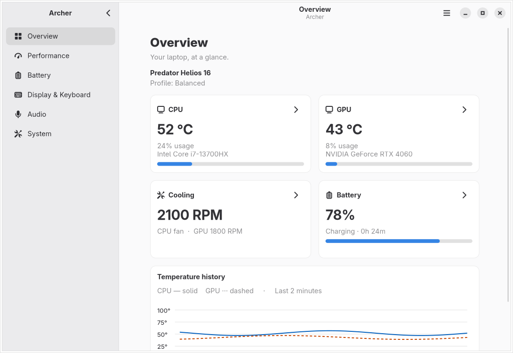

# Archer control center

Archer uses a native GTK4/libadwaita interface with six main destinations. Collapse the left sidebar with its arrow button and expand it with the sidebar button in the content header, or press **Ctrl+B**. The desktop choice is saved across launches. Narrow windows use temporary overlay navigation and preserve your desktop preference. Display, Keyboard, Firmware, and Advanced open as subpages with a Back action.

| Destination | What you can do |
| --- | --- |
| Overview | Read live CPU/GPU, cooling and battery summaries; follow links to controls; inspect two minutes of temperature history. |
| Performance | Select a thermal profile, apply automatic/maximum/manual fan settings, and enable Game Mode. |
| Battery | Check charge and remaining time, inspect per-pack health, review available threshold or fixed charge modes, calibrate, and configure off-state USB charging. |
| Display & Keyboard | Configure graphics mode and panel response, preview zone colors, apply effects, and set backlight timeout. |
| Audio | Select a physical microphone, measure its level, and start or stop a verified rnnoise chain. |
| System | Copy device information, change startup sound, inspect firmware, preview a support report, check peripherals, review a workspace preset, adjust supported touchpad preferences, preview a camera, and access recovery tools. |

Zone colours and effects use the ENE K5130 controller when available, with sysfs/WMI as the fallback. Each backend has its own supported effect list; saved effects use stable names. Older integer effects that cannot be identified safely require selecting and applying the intended effect once. See [the protocol notes](ENE_PROTOCOL.md).

## Session workflows

Choose **System → Session tools** to review a quiet, travel, gaming, conferencing or desk preset. Archer asks the active power-profile provider for a bounded hold when it supports the requested change. Release the hold early from the same page. If a provider cannot hold the requested mode, its plan explains why. The CLI can export and reimport the same versioned preference.

```sh
archer-session workspace travel --minutes 30 --export > travel.json
archer-session workspace --import-file travel.json
archer-session workspace --import-file travel.json --apply
archer-session gpus
archer-session lights
```

**System → Camera** offers a physical source selector, preview and a virtual output when a supported loopback node exists. Framing, monochrome and chroma-key backdrop blur run locally in FFmpeg. Choose the output camera inside the calling app. **Audio → Microphone** offers a source meter and a user-session noise filter. Selecting a source and starting the task is required for capture. Choose a noise preset for the selected microphone and use **Save preset** to retain it. For echo cancellation, select the physical microphone and call output, start the filter and select **Archer Echo Microphone** and **Archer Call Output** in the calling app. Press Stop or exit Archer to release it.

**System → Hardware checks** scans devices and presents an editable report. **Battery** exposes independently readable measurements for each pack. A writable threshold has its own constraints. Fixed Acer charge protection, calibration and variable thresholds are different operations. **Performance** offers each qualified native fan its supported settings. A missing sensor reading appears as unavailable. [Diagnostics guide](diagnostics.md) · [Support matrix](compatibility-2.1.md)

The first launch performs a passive scan. Expand **Show unsupported features** to see unavailable or read-only controls and the reason supplied by the backend. Choose a goal in **Hardware checks**, open each relevant control, and return to mark the step reviewed. Archer saves your place in the local GUI preferences and rescans when you finish. Each affected control presents its own review and authorization.

**System → Sleep and wake** listens for the next sleep cycle you initiate and displays the elapsed time, wake IRQ and per-pack changes where units match. **System → Input** accepts pointer, touch and stylus input inside its test area. **Session tools** reports link, authentication, addressing and DNS evidence from the active provider. It can also play a one-second tone on your current audio output. **Performance** lets you select a native fan, temperature source, curve and expiry, with an explicit return to firmware Auto.

## Firmware updates

Review the releases shown for the specific device. Archer separates stale, unknown, unsupported and blocked results. To choose a release explicitly, run `archer-session firmware` followed by `archer-session firmware-install DEVICE_KEY VERSION` in your terminal. The second command requires fresh metadata, checks the exact device and offered release again after confirmation, and delegates installation to fwupd with its own authorization and progress. Check the vendor's recovery instructions first. [fwupdmgr deployment reference](https://fwupd.github.io/libfwupdplugin/fwupdmgr.html)

The firmware page links to Acer when the DMI vendor and model match a reviewed support route. Check the board, region, installed BIOS, prerequisites and recovery procedure there. A matching support page identifies the model and leaves the choice of firmware with its owner. [Acer ANV16S-41](https://www.acer.com/us-en/support/product-support/ANV16S-41/downloads) · [Acer PHN16-71](https://www.acer.com/us-en/support/product-support/Predator%20PHN16-71/downloads) · [Acer PT516-52s](https://www.acer.com/us-en/support/product-support/Predator_PT516-52s/downloads)

## Preview

The following screenshots use a simulated device; they do not show readings from the host laptop.

<picture>
  <source media="(prefers-color-scheme: dark)" srcset="screenshots/overview-dark.png">
  
</picture>

[Light appearance](screenshots/overview-light.png) · [Dark appearance](screenshots/overview-dark.png) · [Collapsed sidebar](screenshots/sidebar-collapsed.png)

## Appearance and accessibility

The default **System** color scheme follows desktop light/dark preferences. The menu’s **Preferences** dialog also offers Light and Dark overrides. High contrast and supported desktop accent colors apply independently. Charts follow the same appearance and distinguish CPU/GPU with solid/dashed lines. Keyboard colors represent the selected hardware colors rather than the application theme.

This integration uses preferences exposed to libadwaita, normally through the desktop settings portal. It does not reproduce arbitrary GTK or Qt theme packages. A desktop that does not expose a preference receives the native libadwaita default.

GTK 4.12 and libadwaita 1.6 or later are required. System fonts and scaling are inherited; reduced-animation settings are respected. All controls have keyboard navigation and visible focus. Unavailable hardware controls are explained rather than represented as working controls or zero readings.

| Shortcut | Action |
| --- | --- |
| Ctrl+Q | Quit Archer |
| Ctrl+, | Preferences |
| Ctrl+B | Collapse or expand the sidebar |
| Alt+Left | Return from a subpage |
| Escape | Dismiss navigation or a dialog |
| Tab / Shift+Tab | Move focus |
| Space / Enter | Activate the focused control |

## Saving and recovery

Switches and performance profiles apply immediately. Multi-field fan, graphics, and lighting edits use Apply and Reset. Drafts survive navigation, telemetry updates, and appearance changes. Reset restores the latest confirmed settings. Full exit asks before discarding drafts; hiding to the tray preserves them.

While a change is pending, its control group is disabled. Failed switches revert, failed staged edits remain editable, and an inline message explains the error. A timed-out write is reconciled with the service before another write is allowed. Offline/stale service state disables hardware writes and offers retry while retaining readable last-known information.

LCD override, boot animation/sound and backlight timeout have a **Status** row because some firmware cannot report their state; the driver then reads `-1`. A switch appears only for a hardware report or for a request the driver accepted in the service’s current session. An accepted but unverified request is labeled “On requested” or “Off requested”, never as a hardware report. Without either, the group says the state is unknown and offers **Turn on** and **Turn off and save**. **Turn off and save** is always available. It sends Off again and saves it, which repairs a saved On preference or a reported mismatch. **Saved for startup** appears when the startup preference differs from the shown state, cannot be used, or was not saved or confirmed on disk. When the driver accepts a request but saving fails, the request stays visible and the message names the preference that still applies at startup. Resume and driver reloads downgrade earlier evidence, and Archer does not rewrite these settings on resume. With an older Archer service, the group shows a compatibility notice instead of a state.

Graphics settings are labeled **Configured mode**. A successful change records a restart requirement for the current boot; it survives GUI/service restarts and clears after reboot. Archer does not reboot automatically. Firmware checks are advisory and explicit; failed checks never report that firmware is current.

Driver recovery runs one ordered stop/reload/start operation. The GUI waits for its completion record after reconnecting and displays failures; **View recent service logs** includes recovery logs. Hardware writes are serialized, and another pending change receives a busy response. Authorization can remain pending for up to two minutes.

Battery charge protection uses `/etc/archer/battery.json` for both the GUI and battery-only boot/device-event service. Turning it off remains effective across service restarts and device events. Calibration requires verified external power. Archer Game Mode restores each changed CPU policy and NVIDIA persistence state when disabled or after a daemon restart in the same boot. It refuses activation while TLP owns power policy; TLP may reapply its configured profile on AC transitions.

Noise suppression requires the `audio-enhance` module and its rnnoise plugin. The GUI restarts PipeWire in your session and checks that the virtual microphone appears or disappears. A saved configuration is reported separately from a failed session restart or missing source.

Advanced’s model overrides are explicitly persistent. The previous duplicate “one-time” controls actually wrote the persistent configuration and have been removed. Existing custom fan curves remain visible as active; applying another fan mode stops curve control first. This UI does not add a new curve editor.

Closing hides the window only when a system tray host is available and the preference is enabled. Without a tray host it exits normally. If the tray disappears while the window is hidden, Archer presents the window again. Quit always exits.

Appearance, window geometry, sidebar visibility, and tray behavior are stored in `$XDG_CONFIG_HOME/archer/gui.json` (normally `~/.config/archer/gui.json`). Hardware settings use validated schema version 2 in `/etc/archer/settings.json`, with the shared battery policy above, and continue to use D-Bus/polkit authorization.

## System tray

The GUI module enables Archer at desktop login by default, opening the control center and registering its system tray icon when a tray host is available. Existing installations can enable this by rerunning `./install.sh --modules gui --no-confirm`.

Turn **Preferences → Start Archer at login** off to disable automatic startup for your account, or on to restore it. The change takes effect at your next login; it does not quit the current GUI or stop the hardware daemon. Closing to the tray remains a separate preference.

Startup uses the [XDG desktop autostart standard](https://specifications.freedesktop.org/autostart/latest/): `/etc/xdg/autostart/io.github.archer.desktop` supplies the installation default, and `$XDG_CONFIG_HOME/autostart/io.github.archer.desktop` (normally `~/.config/autostart/`) stores your override. Your choice survives upgrades. Uninstall removes the system entry; retained user overrides cannot launch Archer when its executable is absent. Desktops must support XDG autostart; standalone compositors may require enabling their session's autostart support.

Right-click Archer's tray icon to open this menu:

```text
Open
Profile ▸ Eco
          Quiet
          Balanced
          Performance
          Turbo
Exit
```

**Open** presents the full control center. **Profile** shows supported choices only, with a radio mark on the service-confirmed profile. Labels match the Performance page: Eco maps to `low-power`, Performance to `balanced-performance`, and Turbo to `performance`. Quiet and Balanced use `quiet` and `balanced`.

Selecting a profile applies it immediately, even with the window hidden. The GUI and tray use the same save flow and stay synchronized. Profile changes are disabled while a save is pending or the service is offline/stale; Profile is disabled when thermal control is unavailable. Firmware/provider restrictions still apply. A rejected change opens the Performance page with the error and retains the confirmed selection.

**Exit** quits the GUI process and removes its tray icon. If unapplied edits exist, Archer presents the existing discard confirmation first. The separate system daemon remains running to manage hardware; quitting the GUI does not stop the system service.

The panel must provide a StatusNotifierItem host with D-Bus menu support. Archer exports its menu through the standard [StatusNotifierItem Menu property](https://specifications.freedesktop.org/status-notifier-item/latest/status-notifier-item.html) and [D-Bus menu layout](https://cgit.arctica-project.org/libdbusmenu/tree/libdbusmenu-glib/dbus-menu.xml). Tray availability depends on the desktop/panel configuration. Without a host, the window remains the way to access Archer and closing it exits normally.

## Development and verification

The shared `AppState` handles settings, telemetry, connection recovery, and stale reads. Native `Form` groups guard programmatic updates, preserve drafts, and standardize asynchronous actions. The tray reuses the Performance form, publishes supported profiles and state updates, and serves recursive D-Bus menu layouts with stable item IDs. Existing daemon D-Bus method signatures are retained; sensor validity, boot-scoped graphics restart state, firmware-check metadata and binary-control `*_state` objects extend the existing JSON payloads. The additive `BinarySettingChanged` signal triggers a read-only refresh.

Run the hardware-free suites:

```sh
python tests/gui_contract_test.py
xvfb-run -a dbus-run-session -- python tests/gui_test.py
xvfb-run -a dbus-run-session -- python tests/gui_test.py --capture
xvfb-run -a dbus-run-session -- python tests/gui_test.py --capture --high-contrast
xvfb-run -a dbus-run-session -- python tests/gui_test.py --capture --large-text
dbus-run-session -- python tests/dbus_smoke.py
```

The capture runs render all views in light and dark at 360×600, 768×700, 1100×760 and 1440×900, check layout bounds, and write PNGs to `/tmp/archer-ui-review`. The simulated device data is isolated from real hardware. CI runs against Arch’s GTK runtime and uploads the images for review.

Before a release, complete these environment-dependent checks on real systems:

- GNOME, KDE, and a Wayland compositor: live desktop light/dark, accent and high-contrast changes; settings-portal availability; scaling; keyboard and screen-reader navigation.
- Tray registration, right-click Open/Profile/Exit, checked profile updates from both the GUI and tray, selection while hidden, tray-host disappearance and recovery, close-to-tray preference, and dirty-edit confirmation.
- Supported Acer hardware: polkit acceptance/cancellation, fan modes and active-curve transitions, AC/battery changes, calibration, graphics mode/reboot persistence, and audio restart behavior.
- LCD override on a device that reads `-1` (issue #10, PT516-52S), on a device with normal 0/1 readback and on one without the control. Check On, Off, and **Turn off and save** from Off and unknown states. Then check GUI relaunch, daemon restart, reboot, suspend/resume and an external write. Record the physical panel behavior separately from the reported state.
- Firmware errors, slow checks, and available updates against the installed fwupd version.

Automated UI tests and screenshots validate simulated interactions; they do not establish physical hardware compatibility or replace the desktop matrix above.
